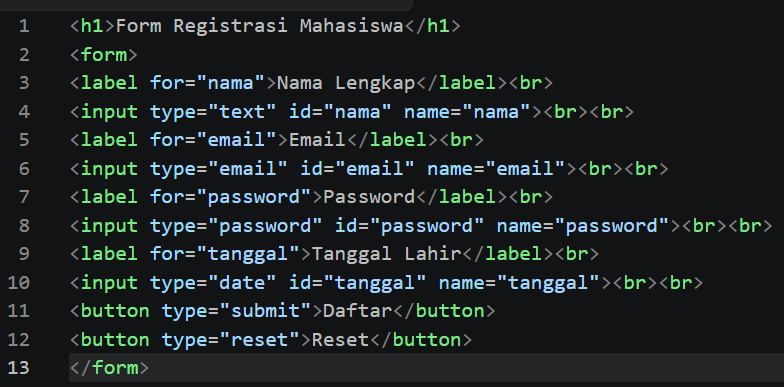
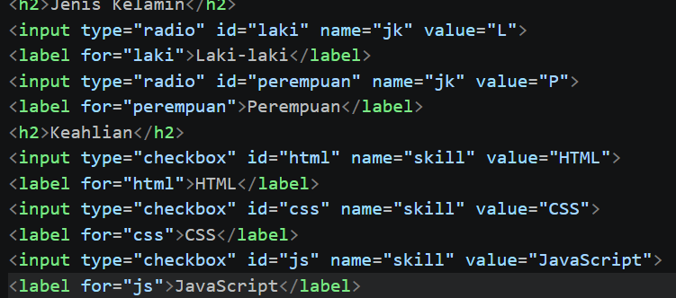
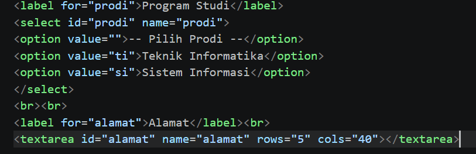
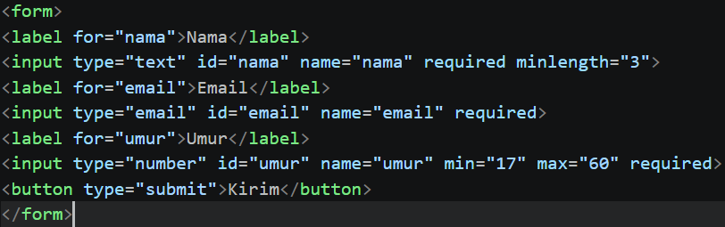
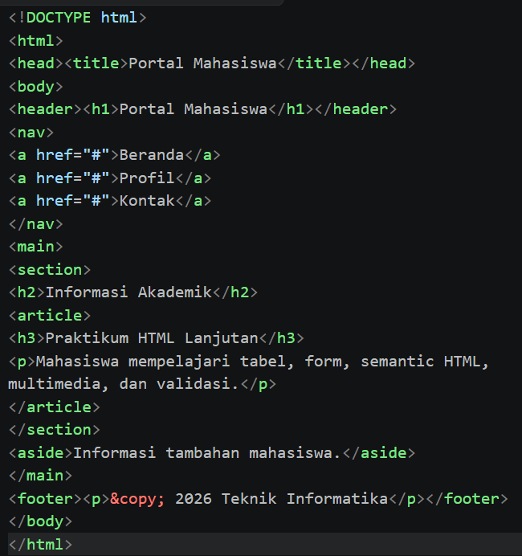
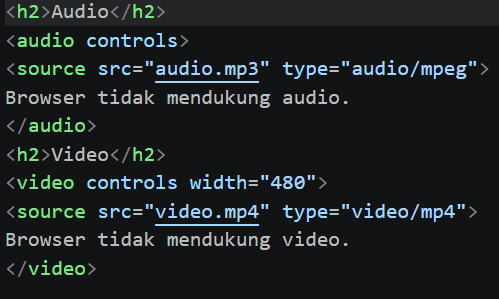
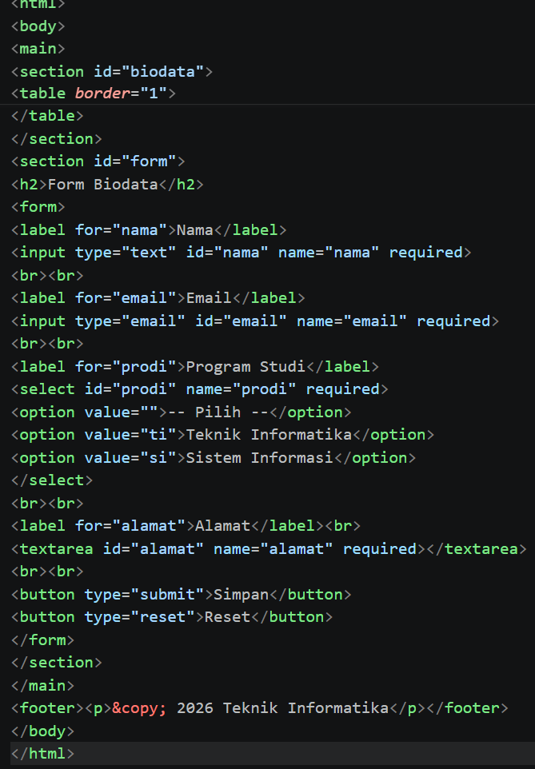

# praktikum-2-html-lanjutan

## Identitas Mahasiswa

**Nama:** Fani Gilang Pratama
**NIM:** 312510065
**Kelas:** I253B  
**Mata Kuliah:** Pemrograman Web

## Tujuan Praktikum

Praktikum ini bertujuan untuk:

1. Memahami struktur dasar HTML.
2. Memahami tag-tag dasar HTML.
3. Membuat dokumen HTML.

# 1. Membuat Tabel Data Mahasiswa
<h1>Data Mahasiswa</h1>
<table border="1">
<tr><th>NIM</th><th>Nama</th><th>Program Studi</th></tr>
<tr><td>31241001</td><td>Andi</td><td>Teknik Informatika</td></tr>
<tr><td>31241002</td><td>Budi</td><td>Teknik Informatika</td></tr>
<tr><td>31241003</td><td>Tegar</td><td>Teknik Informatika</td></tr>
<tr><td>31241004</td><td>Fani</td><td>Teknik Informatika</td></tr>
<tr><td>31241005</td><td>Rubben</td><td>Teknik Informatika</td></tr>
</table>
</body>

# 2. Mengembangkan Tabel dengan thead, tbody, dan tfoot
<table border="1">
<caption>Nilai Praktikum</caption>
<thead><tr><th>No</th><th>Nama</th><th>Nilai</th></tr></thead>
<tbody>
<tr><td>1</td><td>Andi</td><td>85</td></tr>
<tr><td>2</td><td>Budi</td><td>90</td></tr>
<tr><td>3</td><td>Tegar</td><td>79</td></tr>
<tr><td>3</td><td>Fani</td><td>75</td></tr>
<tr><td>3</td><td>Rubbben</td><td>88</td></tr>
</tbody>
<tfoot><tr><td colspan="2">Rata-rata</td><td>83.4</td></tr></tfoot>
</table>
</html>

Kode tersebut berfungsi untuk membuat tabel terstruktur lengkap dengan judul tabel (<caption), bagian kepala (<thead), badan data (<tbody), serta bagian kaki (<tfoot) yang menggunakan atribut colspan="2" untuk menggabungkan dua sel kolom guna menampilkan nilai rata-rata.

# 3. Membuat Form Registrasi Mahasiswa

Kode HTML di atas adalah struktur dasar untuk membuat halaman web yang menampilkan tabel data mahasiswa. Tag utama yang digunakan meliputi <html sebagai akar dokumen, <head untuk informasi latar, <body untuk isi halaman, <h1 untuk judul, serta tag tabel (<table, <tr, <th, <td) untuk menyusun baris, header, dan sel data.

# 4. Radio Button dan Checkbox

Kode tersebut berfungsi untuk membuat elemen pilihan interaktif, yaitu tombol radio (type="radio") untuk memilih satu opsi jenis kelamin dan kotak centang (type="checkbox") untuk memilih satu atau beberapa opsi keahlian yang masing-masing dilengkapi dengan label keterangan

# 5. Select dan Textarea

Kode tersebut berfungsi untuk membuat elemen pilihan menu dropdown (<select dan <option) guna memilih program studi serta kotak teks area multi-baris (<textarea) untuk memasukkan alamat lengkap, yang keduanya dilengkapi dengan label keterangan (<label).

# 6. Validasi Form Dasar

Kode tersebut berfungsi untuk membuat formulir dengan fitur validasi form dasar, yang meliputi atribut required (wajib diisi), minlength (panjang minimum teks), serta batasan angka minimum dan maksimum (min dan max) untuk memastikan data yang dikirimkan sesuai dengan aturan sebelum form diproses.

# 7. Membuat Halaman Semantic HTML

Kode tersebut berfungsi untuk menerapkan Semantic HTML dalam menyusun struktur halaman web yang bermakna, yang terdiri dari bagian kepala halaman (<header), menu navigasi (<nav), konten utama (<main), seksi konten (<section), hingga artikel mandiri (<article).

# 8. Menambahkan Multimedia

Kode tersebut berfungsi untuk menambahkan elemen multimedia pada halaman web, yaitu tag <audio untuk menampilkan pemutar suara dengan kontrol bawaan serta tag <video untuk memutar video dengan lebar yang ditentukan (width="480"), lengkap dengan teks cadangan jika browser tidak mendukung format media tersebut

# 9. Proyek Mini — Form Biodata Mahasiswa

Kode tersebut berfungsi untuk membangun sebuah proyek mini (Halaman Biodata Mahasiswa) yang menggabungkan seluruh materi HTML Lanjutan, yang mencakup struktur tata letak menggunakan Semantic HTML (<header, <nav, <main, <section, <footer), penyajian informasi dengan Tabel, serta pembuatan Form Biodata interaktif yang dilengkapi dengan elemen pilihan (<select, <textarea) dan fitur validasi dasar (required).
